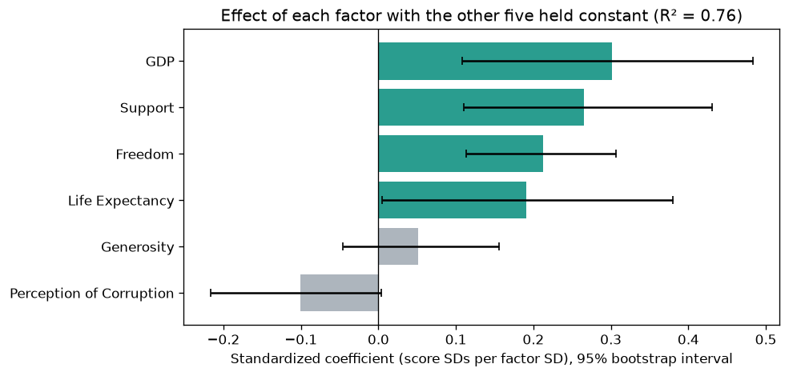
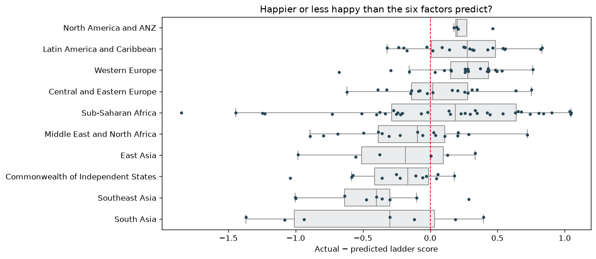

# What Makes a Country Happy? — World Happiness Report 2021

An analysis in Python of the **World Happiness Report 2021** (149 countries) asking
which of the report's six factors move a country's happiness ("ladder") score, which ones still matter
once the others are held constant, and which countries are happier than their circumstances predict.

**Skills:** pandas · NumPy · SciPy (correlation, multiple regression, bootstrap intervals, ANOVA, multiple-testing correction) · seaborn · Matplotlib · Plotly choropleth · Jupyter · pytest · GitHub Actions

---

## Key findings

**1. Wealth, health and social support track happiness most closely.**

| Factor | Correlation with ladder score | p-value |
|---|---|---|
| Logged GDP per capita | 0.79 | 5.2e-33 |
| Healthy life expectancy | 0.77 | 3.0e-30 |
| Social support | 0.76 | 6.1e-29 |
| Freedom to make life choices | 0.61 | 2.1e-16 |
| Perceptions of corruption | −0.42 | 8.9e-08 |
| Generosity | −0.02 | 0.83 (not significant) |


**2. Combined, the factors explain 76% of happiness, but mostly as a bundle.**
A multiple regression of score on all six factors (R² = 0.76) shows GDP, social support and freedom
each still matter with the others held constant. Generosity doesn't, and perceived corruption is borderline.
But 88% of the explained variance is *shared*: rich countries also tend to be healthy and well supported,
so the data can't credit any one factor. Freedom has the largest unique share because it overlaps least with the rest.



**3. Latin America and Western Europe are happier than their numbers predict.**
Comparing each country's actual score with the score its six factors predict, the gaps differ by region
(ANOVA p < 0.001). Latin America (+0.25; 15 of 20 countries above prediction) and Western Europe
(+0.24; 18 of 21) remain significant after correcting for testing ten regions. Southeast Asia is below prediction
in 8 of 9 countries (−0.44), which is suggestive but doesn't survive the correction.



**4. Among the happiest countries, freedom and trust matter more than money — with caveats.**
In the 20 highest-scoring countries, freedom (r = 0.73, 95% CI 0.43–0.89) and perceived corruption
(r = −0.65) are significant, while GDP drops to 0.23 (not significant). In the 20 lowest-scoring countries
no factor is significant. Scores vary far less within these groups (spread 0.26 and 0.46 vs 1.07 overall),
so treat these subgroup results as directional.

| Top 20 | Bottom 20 |
|---|---|
|  |  |

**5. Regions differ.** Average scores range from 4.44 (South Asia) to 7.13 (North America & ANZ).
Within regional groups, social support stands out in Asia (r = 0.84), healthy life expectancy in the
Americas (0.86), and perceived corruption in Europe (−0.81).


---

## Approach

1. **Prepare** — load the 2021 report and keep the ladder score and the six raw factors.
2. **Explore** — distribution of ladder scores and average score by region.
3. **Test relationships** — scatter plots of each factor vs. score (colored by region) with that factor's own trend line, plus Pearson r and p-values from `scipy.stats`.
4. **Segment** — correlation heatmaps for the 20 happiest vs. 20 least happy countries and for five regional groups, with confidence intervals.
5. **Model** — multiple regression on all six factors: standardized coefficients, bootstrap intervals, unique vs. shared variance, and VIFs.
6. **Residuals** — which countries and regions score above or below prediction, tested with ANOVA and Bonferroni-corrected t-tests.
7. **Robustness** — Spearman rank correlations to check the results don't hinge on outliers.
8. **Map** — a Plotly choropleth of happiness scores worldwide.

The full write-up, including the motivation for the project, is in
[`Analytics - World happiness Report 2021.pdf`](Analytics%20-%20World%20happiness%20Report%202021.pdf).

## Repository structure

```
happiness.py                        shared loading, statistics and chart functions
JupyterCodes/
  score_by_region.ipynb             average score by region
  cor-happy.ipynb                   factor correlations, p-values, scatter plots
  regional.ipynb                    top/bottom-20 and regional heatmaps, world map
  drivers.ipynb                     combined regression, happier-than-predicted countries, robustness
tests/                              checks the numbers in this README and the chart and model logic
DataFile/
  world-happiness-report-2021.csv   main dataset (149 countries)
  gdp_csv.csv                       World Bank total GDP by country, 1960–2016 (reference only: the
                                    analysis uses the report's own GDP-per-capita column)
img/                                charts (regenerated by the notebooks)
Analytics - World happiness Report 2021.pdf   written report
```

## How to run

```bash
pip install -r requirements.txt
jupyter notebook JupyterCodes/        # charts are saved to img/

pip install -r requirements-dev.txt   # optional: tests
python -m pytest -q
```

GitHub Actions runs the tests and executes every notebook top to bottom on Python 3.11 and 3.13.

## Limitations

These are associations from one year of cross-country data, not causes. The combined model shows how
entangled the factors are, but it can't tell which way influence runs (does freedom make people happier,
or do happier societies sustain more freedom?). Happiness is self-reported, so regional gaps may partly
reflect how people answer survey questions. Country averages also hide differences within countries.

**Data source:** [World Happiness Report 2021](https://worldhappiness.report/ed/2021/).
