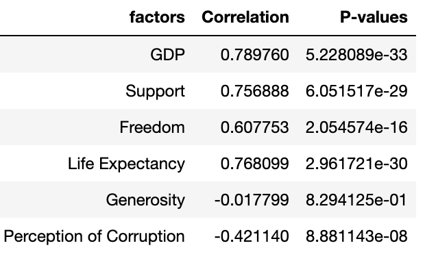
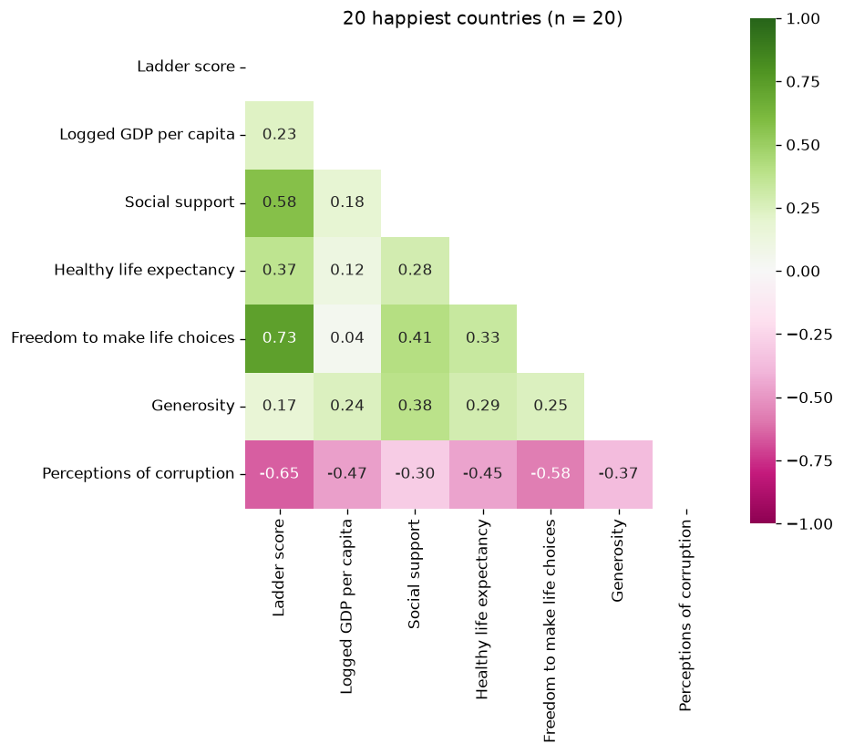
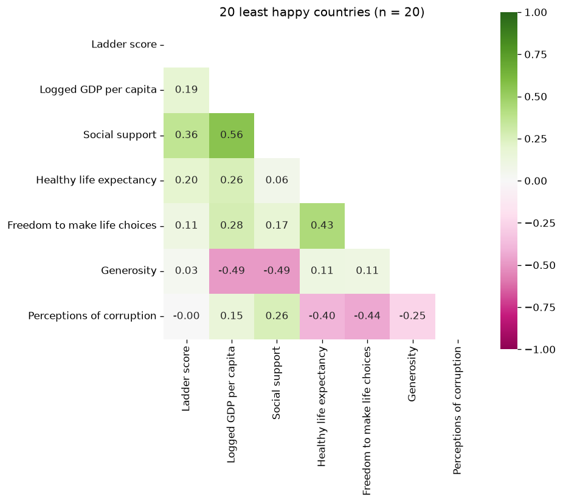

# What Makes a Country Happy? — World Happiness Report 2021

An exploratory analysis in Python of the **World Happiness Report 2021** (149 countries) asking
which of the report's six factors move a country's happiness ("ladder") score, and whether
the answer changes by region and between the happiest and least happy countries.

**Skills:** pandas · NumPy · SciPy (Pearson correlation & p-values) · seaborn · Matplotlib · Plotly choropleth · Jupyter

---

## Key findings

**1. Wealth, health and social support track happiness most closely.**

| Factor | Correlation with ladder score | p-value |
|---|---|---|
| Logged GDP per capita | 0.79 | 5.2e-33 |
| Healthy life expectancy | 0.77 | 3.0e-30 |
| Social support | 0.76 | 6.1e-29 |
| Freedom to make life choices | 0.61 | 2.1e-16 |
| Perceptions of corruption | −0.42 | 8.9e-08 |
| Generosity | −0.02 | 0.83 (not significant) |



**2. Among the happiest countries, freedom and trust matter more than money.**
In the 20 highest-scoring countries, freedom (r = 0.73) and perceived corruption (r = −0.65)
are the strongest factors, while GDP drops to 0.23. In the 20 lowest-scoring countries no factor
is strongly related; social support is the highest at 0.36.

| Top 20 | Bottom 20 |
|---|---|
|  |  |

**3. Regions differ.** Average scores range from 4.4 (South Asia) to 7.1 (North America & ANZ).
Social support stands out in Asia, healthy life expectancy and freedom in the Americas, and
perceived corruption in Europe.

---

## Approach

1. **Prepare** — load the 2021 report and drop the confidence-interval and "Explained by" columns to keep the six raw factors.
2. **Explore** — distribution of ladder scores and average score by region.
3. **Test relationships** — scatter plots of each factor vs. score (colored by region), with Pearson r and p-values from `scipy.stats`.
4. **Segment** — correlation heatmaps for the top 20 vs. bottom 20 countries and for Asia, Europe, the Americas and Africa.
5. **Map** — a Plotly choropleth of happiness scores worldwide.

The full write-up, including the motivation for the project, is in
[`Analytics - World happiness Report 2021.pdf`](Analytics%20-%20World%20happiness%20Report%202021.pdf).

## Repository structure

```
DataFile/
  world-happiness-report-2021.csv   main dataset (149 countries)
  gdp_csv.csv                       World Bank GDP by country, 1960s onward
JupyterCodes/
  cor-happy.ipynb                   factor correlations and p-values
  regional.ipynb                    top/bottom-20 and regional heatmaps, world map
  score_by_region.ipynb             average score by region
img/                                exported charts
Analytics - World happiness Report 2021.pdf   written report
```

## How to run

```bash
pip install pandas numpy scipy seaborn matplotlib plotly jupyter
cd DataFile                     # the notebooks read the CSV from the working directory
jupyter notebook ../JupyterCodes/
```

## Limitations

These are correlations, not causes, and the factors are closely related to each other
(richer countries also tend to live longer). Country-level averages also hide differences within countries.

**Data source:** [World Happiness Report 2021](https://worldhappiness.report/ed/2021/).
